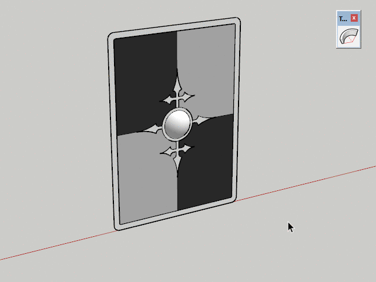
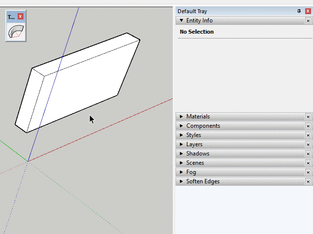
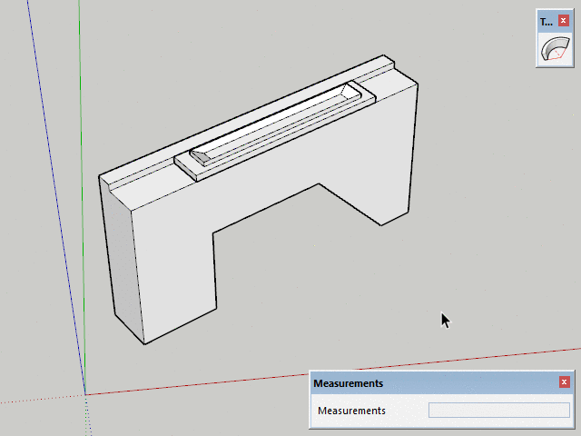
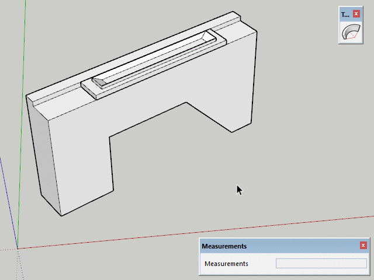
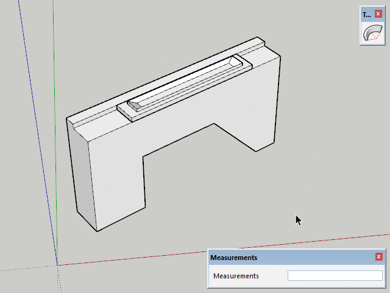

# TrueBend

SketchUp extension allowing you to bend instances to a given degree or radius, preserving the original length.

## Example Usage

The length of the reference segment is preserved as the instance is bent:

Use the VCB to enter an accurate bend angle:

Use the VCB to adjust the segmentation by appending "s":

Toggle soft+smooth for the newly created edges:

## VCB Input

A number without a suffix is read in the current input mode: the angle, the distance, the radius or the sagitta of the bend. The VCB label shows which mode is current.

Switch the input mode with the four input mode buttons in the viewport, or by appending a suffix to the value:

* Angle Input: `45deg`
* Bend Distance: `500mm`, or any other length unit. (This should be a value less than the width of the bottom from bounding box segment.)
* Bend Radius: `400r`. A length unit goes before the "r", as in `400mmr`.
* Bend Sagitta: `50sg`. The sagitta is the height of the arc above its chord. A length unit goes before the "sg", as in `50mmsg`.

A bend can have a sagitta of at most about 36% of the length that is bent, which it has at a bend of about 267 degrees. A larger value is clamped to that. To bend further, drag the handle or enter an angle.

The input mode is remembered between sessions.

Appending "s" sets the segment count without changing the input mode:

* Segment Count: `8s`

## Bend Options

Two more buttons in the viewport toggle the bend options. The context menu has the same options.

* Segmented: Bend in straight segments.
* Soften/Smooth: Soften and smooth the edges between the segments. A bend that is not segmented is always soft and smooth.

## Bend Axis

The instance bends along its red axis, unless it has no length along that axis. To bend along another axis, do one of the following:

* Click the red, green or blue axis button in the viewport.
* Click an edge of the bounding box that runs along the axis.
* Press an arrow key: Right for red, Left for green and Up for blue.
* Pick the axis from Bend Along in the context menu.

Along each axis the instance can bend in two directions, and each direction has its own handle. Drag the other handle to bend in the other direction, or choose the axis again with its button, an edge or its arrow key.
